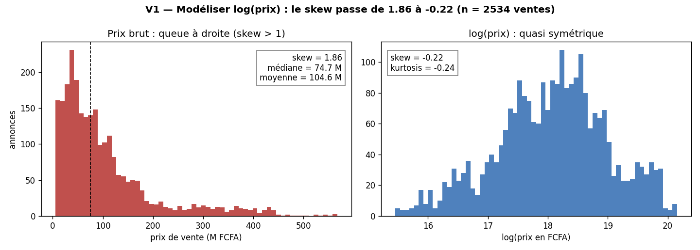
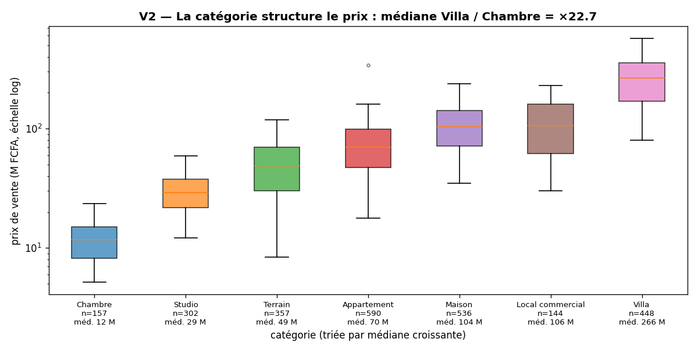
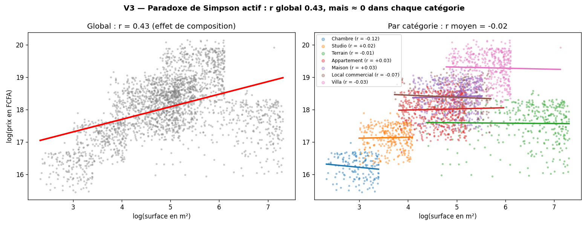
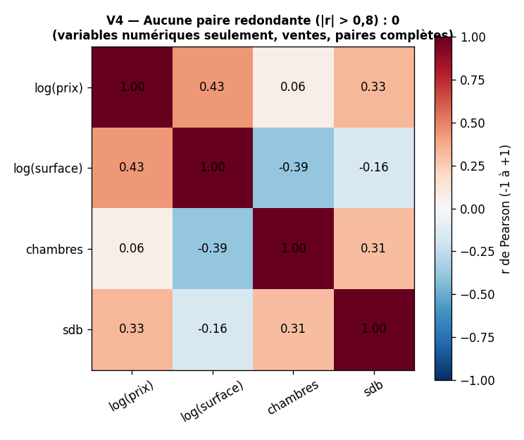
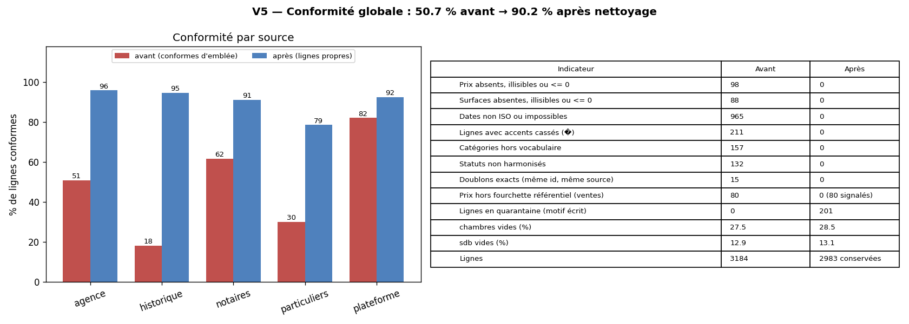
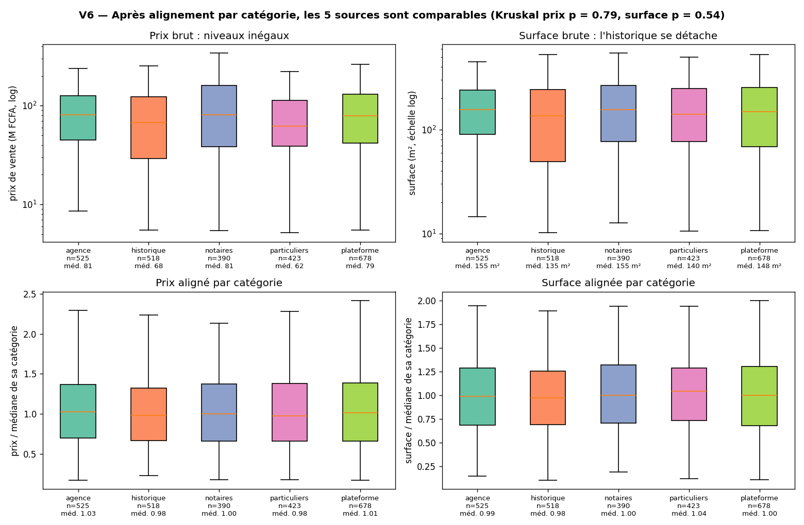

## Visualisations de restitution (compétence 4)

Données : **corpus conservé** (`corpus_conserve.csv` = propres + avertissements), segment `vente` : 2534 ventes.
Écart assumé avec la fiche, qui cite `donnees_propres.csv` : les 80 prix hors fourchette plausibles sont gardés en avertissement (décision 3.9) ;
les retirer tronquerait la queue de prix (skew 1.86 avec eux, 1.77 sans) et rendrait V1/V2 circulaires.

**Conclusion V1.** Le skew de `prix` est de **1.86** (moyenne 104.6 M contre médiane 74.7 M) ; il tombe à **-0.22** avec `log(prix)`. Décision confirmée : la cible est `log(prix)` sur le segment vente. *Justifie les décisions 1.8 et 3.9.*

**Conclusion V2.** La médiane passe de 11.7 M (Chambre) à 266.0 M (Villa), soit **×22.7** ; la catégorie explique **74 %** de la variance de log(prix). `categorie` est la variable prioritaire (one-hot en comp 5/6). *Justifie 3.3 et 3.9.*

**Conclusion V3.** `r` global = **0.43** ; `r` moyen par catégorie = **-0.02** (|r| max = 0.12, p minimum = 0.14) : le paradoxe de Simpson reste actif sur les données conservées. Implications : **pas de `prix_m2`** (dérivé de la cible, fuite type 1) et **pas de `surface` seule** ; tester l'interaction `categorie × surface` en comp 6. *Justifie 3.4, 3.5 et 2.7.*

**Conclusion V4.** **Aucune paire** au-dessus de |r| = 0,8 (plus forte corrélation : log(prix) / log(surface), |r| = 0.43, calculée sur 1466 lignes complètes). Les corrélations de `sdb` et de `chambres` avec le prix sont des effets de composition (voir V3) : vérifier le VIF en comp 5/6. *Justifie 3.13.*

**Conclusion V5.** Conformité globale de **50.7 %** avant (lignes sans aucune correction ni alerte) à **90.2 %** après (lignes propres, corrections tracées) ; les 9.8 % restants sont 201 lignes en quarantaine et 111 avertissements. Mesures « après » relues depuis `corpus_conserve.csv`, pas depuis les objets internes.

| Indicateur | Avant | Après |
|---|---|---|
| Prix absents, illisibles ou <= 0 | 98 | 0 |
| Surfaces absentes, illisibles ou <= 0 | 88 | 0 |
| Dates non ISO ou impossibles | 965 | 0 |
| Lignes avec accents cassés (�) | 211 | 0 |
| Catégories hors vocabulaire | 157 | 0 |
| Statuts non harmonisés | 132 | 0 |
| Doublons exacts (même id, même source) | 15 | 0 |
| Prix hors fourchette référentiel (ventes) | 80 | 0 (80 signalés) |
| Lignes en quarantaine (motif écrit) | 0 | 201 |
| chambres vides (%) | 27.5 | 28.5 |
| sdb vides (%) | 12.9 | 13.1 |
| Lignes | 3184 | 2983 conservées |

*Justifie 3.1 à 3.6.*

**Conclusion V6.** Après alignement par catégorie, les 5 sources sont **comparables** : Kruskal sur le prix p = 0.79, sur la surface p = 0.54. En brut, la surface de l'`historique` (KS p < 0,0001) et de l'`agence` (KS p = 0.0037) se détache, mais c'est un **effet de composition** (khi2 catégorie × source p = 3e-46) : l'historique contient 14.1 % de chambres contre 2.1–5.9 % dans les autres sources. Source atypique : **`historique`** (mélange de catégories uniforme, période 2018-2020 seulement, ni `statut` ni `transaction`) ; elle ne l'est ni par le niveau de prix ni, une fois alignée par catégorie, par la surface. **Décision pour comp 5 et 7 :** ne pas utiliser `source` comme variable explicative (fuite type 4) et stratifier le split sur `categorie` ; `source` ne sert qu'à l'audit. *Justifie 3.2, 3.3 et 3.12.*

### Cohérence avec les diagnostics de la comp 2

| Indicateur | Comp 2 (données brutes) | Comp 4 (données conservées) |
|---|---|---|
| skew de prix (ventes) | 1.86 | 1.86 |
| skew de log(prix) | -0.22 | -0.22 |
| ratio médiane villa / chambre | ×22.5 | ×22.7 |
| corrélation prix ~ surface (global) | ρ = 0.43 | r = 0.43 |

Les valeurs sont quasi identiques : le nettoyage n'a pas déformé les distributions. Les {x['n_ventes_retirees']} ventes retirées (quarantaine) ont toutes un prix valide : elles sont rejetées pour surface ou date inexploitable, ou comme doublons, pas pour des valeurs extrêmes.

### Récapitulatif {figure, question, décision comp 3 justifiée}

| Figure | Question | Décision comp 3 justifiée |
|---|---|---|
| V1 | La cible est-elle modélisable telle quelle ? | 1.8 + 3.9 : modéliser log(prix) ; outliers plausibles conservés en avertissement |
| V2 | La catégorie structure-t-elle le prix ? | 3.3 : synonymes et casse harmonisés (7 catégories) ; 3.9 : fourchettes par catégorie |
| V3 | La relation prix ~ surface tient-elle par catégorie ? | 3.4 + 3.5 : surfaces normalisées, surfaces <= 0 rejetées ; 2.7 : Simpson actif |
| V4 | Quelles numériques sont redondantes ? | 3.13 : chambres/sdb non imputées (vides structurels) ; VIF à vérifier en comp 5/6 |
| V5 | Le nettoyage a-t-il supprimé les anomalies ? | 3.1 à 3.6 : quarantaine, normalisation, mojibake, doublons exacts |
| V6 | Les 5 sources sont-elles comparables ? | 3.2 + 3.3 + 3.12 : mojibake, catégories et transaction alignés sur les 5 sources |
