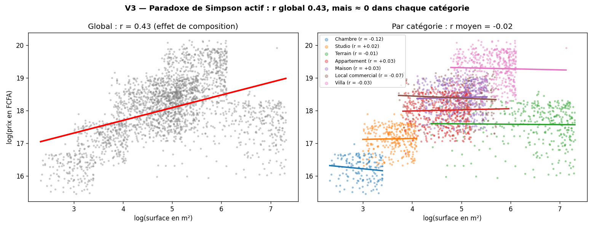
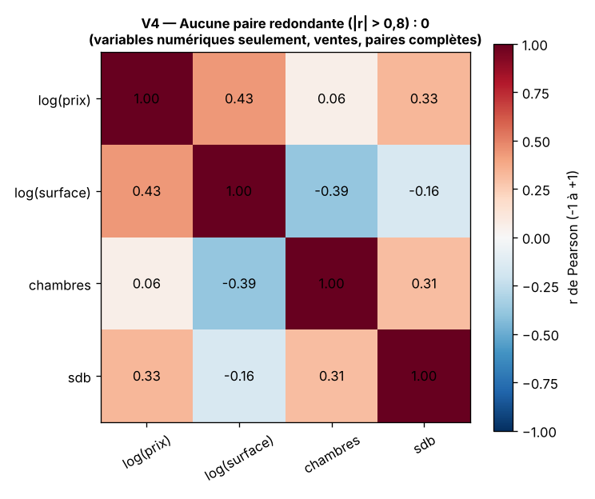

# Rapport de qualité — KerData (corpus de 5 sources)

Généré automatiquement par `run_pipeline.py`. Chaque ligne des 3184 lignes lues finit dans **un seul** fichier.

## Bilan global

| Fichier | Lignes | Part |
|---|---|---|
| `donnees_propres.csv` | 2872 | 90.2 % |
| `avertissements.csv` (conservées, signalées) | 111 | 3.5 % |
| `quarantine.csv` (rejetées, avec raison) | 201 | 6.3 % |
| **Total** | **3184** | 100 % |

Corpus conservé (propres + avertissements) : **2983 lignes** (93.7 %), fichier `corpus_conserve.csv`.

## Les 6 mesures obligatoires

| # | Mesure | Valeur |
|---|---|---|
| 1 | Taux de manquants par colonne (état initial, toutes sources) | voir tableau « Manquants » ; colonnes les plus vides : transaction 49.6 %, chambres 27.5 %, statut 16.6 %, sdb 12.9 %, surface 2.5 %, prix 2.4 % |
| 2 | Doublons exacts | **15** (tous dans `plateforme`, identifiants dupliqués) |
| 3 | Doublons probables / conflits entre sources | **0** probables, **0** conflits (clé : date + ville + catégorie + surface, après correction du mojibake) |
| 4 | Erreurs de conversion par champ | prix **18**, surface **4**, date **6** (valeurs non vides non convertibles) |
| 5 | Corrigés / quarantaine / avertissements | **1407** lignes corrigées (1740 corrections tracées dans `journal_corrections.csv`) / **201** / **111** |
| 6 | Taux d'enregistrements entièrement conformes | **50.7 %** conformes d'emblée (sans correction ni alerte), **90.2 %** propres après corrections |

## Manquants : mécanisme et traitement

| source | champ | vides | non_convertibles | pct_manquants_ou_illisibles | mecanisme | traitement |
|---|---|---|---|---|---|---|
| agence | transaction | 640 | 0 | 100.0 | structurel (100 % absent dans la source) | imputée par seuil de prix (3 M FCFA), provenance tracée, SANS indicateur de manque (fuite type 4) |
| historique | transaction | 528 | 0 | 100.0 | structurel (100 % absent dans la source) | imputée par seuil de prix (3 M FCFA), provenance tracée, SANS indicateur de manque (fuite type 4) |
| historique | ville | 8 | 0 | 1.5 | aléatoire (MCAR plausible) | conservée avec avertissement (région présente) |
| historique | prix | 0 | 10 | 1.9 | aléatoire (MCAR plausible) | quarantaine (règle bloquante) : jamais imputé, c'est la cible |
| historique | statut | 528 | 0 | 100.0 | structurel (100 % absent dans la source) | conservé vide : source qui ne le fournit pas ; pas d'indicateur de manque |
| notaires | date | 0 | 6 | 1.5 | aléatoire (MCAR plausible) | quarantaine (règle bloquante) |
| notaires | transaction | 410 | 0 | 100.0 | structurel (100 % absent dans la source) | imputée par seuil de prix (3 M FCFA), provenance tracée, SANS indicateur de manque (fuite type 4) |
| notaires | prix | 14 | 0 | 3.4 | aléatoire (MCAR plausible) | quarantaine (règle bloquante) : jamais imputé, c'est la cible |
| notaires | sdb | 410 | 0 | 100.0 | structurel (100 % absent dans la source) | conservé vide ; imputation par groupe dans le pipeline (fit sur train, comp 5/7), sans indicateur de manque |
| particuliers | prix | 61 | 2 | 8.6 | aléatoire (MCAR plausible) | quarantaine (règle bloquante) : jamais imputé, c'est la cible |
| particuliers | surface | 75 | 4 | 10.8 | aléatoire (MCAR plausible) | quarantaine (règle bloquante) |
| plateforme | prix | 0 | 6 | 0.7 | aléatoire (MCAR plausible) | quarantaine (règle bloquante) : jamais imputé, c'est la cible |
| plateforme | surface | 5 | 0 | 0.6 | aléatoire (MCAR plausible) | quarantaine (règle bloquante) |
| plateforme | chambres | 875 | 0 | 100.0 | structurel (100 % absent dans la source) | conservé vide ; imputation par groupe dans le pipeline (fit sur train, comp 5/7), sans indicateur de manque |

## Doublons

| type | nombre | decision |
|---|---|---|
| exact (intra-source) | 15 | supprimé du corpus (mis en quarantaine, 1re occurrence conservée) |
| ID dupliqué, contenu différent | 0 | conservé avec avertissement (arbitrage manuel) |
| probable inter-sources (même date, ville, catégorie, surface) | 0 | signalé, jamais fusionné sans preuve |
| conflit (même bien, prix à plus de 20 %) | 0 | signalé seulement |

## Aberrants

| champ | methode | decision | nombre |
|---|---|---|---|
| prix | fourchette du référentiel catégoriel | avertissement (plausible) | 80 |
| surface | fourchette typique du référentiel | avertissement | 3 |
| prix | seuils atypiques (<100 k ou >2 Md, ventes) | avertissement | 0 |
| surface | seuils atypiques (<5 ou >2000 m²) | avertissement | 0 |
| prix | prix <= 0 | quarantaine | 5 |
| surface | surface <= 0 | quarantaine | 4 |
| prix | IQR par catégorie sur log(prix) (confirmation) | confirmation seulement, aucune action | 9 |
| prix | … dont hors fourchette du référentiel | recoupement des 2 méthodes | 1 |

Détail par source : `reports/comp3_outliers.csv`.

## Motifs de quarantaine

| motif | lignes |
|---|---|
| surface absente | 80 |
| prix absent | 75 |
| prix non numérique | 18 |
| doublon exact | 15 |
| date non interprétable ou absente | 6 |
| prix <= 0 | 5 |
| surface <= 0 | 4 |
| surface non numérique | 4 |
| date future pour une vente conclue | 1 |

## Motifs d'avertissement

| motif | lignes |
|---|---|
| prix hors fourchette du référentiel (plausible) | 80 |
| statut incohérent avec la transaction | 14 |
| ville absente | 8 |
| région et ville incompatibles (non corrigé) | 4 |
| date future (non vendue) | 4 |
| surface hors fourchette typique de la catégorie | 3 |

## Transaction inférée : validation par le statut

La colonne `transaction` est absente de 3 sources ; elle est inférée par seuil de prix (3 M FCFA, 0 erreur sur les lignes à transaction connue).
Contrôle indépendant : dans les sources étiquetées, `Loué` (168 lignes) et `Disponible` (214 lignes) n'apparaissent qu'avec des locations (0 avec une vente). Pour `notaires`, seul `Vendu` existe : le contrôle ne vaut que pour l'agence (106 loyers confirmés par leur statut) ; `historique` n'a pas de statut et n'est donc pas contrôlable.

| source | transaction_inferee | lignes_inferees | confirmees_par_statut | pct_confirme |
|---|---|---|---|---|
| agence | location | 106 | 106 | 100.0 |
| agence | vente | 529 | 529 | 100.0 |
| notaires | vente | 396 | 396 | 100.0 |

## Limites reconnues

- **Volume agence :** 640 lignes lues pour 680 annoncées dans la fiche de conception (−40) ; non comblé.
- **Quarantaine volontairement stricte :** 98 lignes sans prix exploitable et 88 sans surface exploitable (absentes ou illisibles) sont rejetées par la règle bloquante, même si certaines surfaces seraient imputables ; 67.7 % de la quarantaine vient de `particuliers`.
- **Transaction inférée** pour 1549 lignes : fondée sur un seuil validé, mais reste une inférence (colonne `transaction_origine`).
- **Doublons probables inter-sources : 0** sur la clé stricte ; des doublons dont la date, la ville ou la surface diffèrent légèrement ne seraient pas vus.
- **Fourchettes du référentiel indicatives :** les prix hors fourchette sont conservés en avertissement, jamais supprimés.
- **Colonnes écartées du corpus final :** `quartier`, `pieces`, `description`, `date_expiration`, `commercial`, `devise` (propres à une source ou redondantes avec `transaction`).
- **Aucune imputation ici :** `chambres` et `sdb` restent vides là où la source ne les fournit pas ; l'imputation par groupe se fera dans le pipeline, ajustée sur le train uniquement.

## Visualisations de restitution (compétence 4)

Données : **corpus conservé** (`corpus_conserve.csv` = propres + avertissements), segment `vente` : 2534 ventes.
Écart assumé avec la fiche, qui cite `donnees_propres.csv` : les 80 prix hors fourchette plausibles sont gardés en avertissement (décision 3.9) ;
les retirer tronquerait la queue de prix (skew 1.86 avec eux, 1.77 sans) et rendrait V1/V2 circulaires.

**Conclusion V1.** Le skew de `prix` est de **1.86** (moyenne 104.6 M contre médiane 74.7 M) ; il tombe à **-0.22** avec `log(prix)`. Décision confirmée : la cible est `log(prix)` sur le segment vente. *Justifie les décisions 1.8 et 3.9.*

**Conclusion V2.** La médiane passe de 11.7 M (Chambre) à 266.0 M (Villa), soit **×22.7** ; la catégorie explique **74 %** de la variance de log(prix). `categorie` est la variable prioritaire (one-hot en comp 5/6). *Justifie 3.3 et 3.9.*

**Conclusion V3.** `r` global = **0.43** ; `r` moyen par catégorie = **-0.02** (|r| max = 0.12, p minimum = 0.14) : le paradoxe de Simpson reste actif sur les données conservées. Implications : **pas de `prix_m2`** (dérivé de la cible, fuite type 1) et **pas de `surface` seule** ; tester l'interaction `categorie × surface` en comp 6. *Justifie 3.4, 3.5 et 2.7.*

**Conclusion V4.** **Aucune paire** au-dessus de |r| = 0,8 (plus forte corrélation : log(prix) / log(surface), |r| = 0.43, calculée sur 1466 lignes complètes). Les corrélations de `sdb` et de `chambres` avec le prix sont des effets de composition (voir V3) : vérifier le VIF en comp 5/6. *Justifie 3.13.*

**Conclusion V5.** Conformité globale de **50.7 %** avant (lignes sans aucune correction ni alerte) à **90.2 %** après (lignes propres, corrections tracées) ; les 9.8 % restants sont 201 lignes en quarantaine et 111 avertissements. Mesures « après » relues depuis `corpus_conserve.csv`, pas depuis les objets internes.

| Indicateur | Avant | Après |
|---|---|---|
| Prix absents, illisibles ou <= 0 | 98 | 0 |
| Surfaces absentes, illisibles ou <= 0 | 88 | 0 |
| Dates non ISO ou impossibles | 965 | 0 |
| Lignes avec accents cassés (�) | 211 | 0 |
| Catégories hors vocabulaire | 157 | 0 |
| Statuts non harmonisés | 132 | 0 |
| Doublons exacts (même id, même source) | 15 | 0 |
| Prix hors fourchette référentiel (ventes) | 80 | 0 (80 signalés) |
| Lignes en quarantaine (motif écrit) | 0 | 201 |
| chambres vides (%) | 27.5 | 28.5 |
| sdb vides (%) | 12.9 | 13.1 |
| Lignes | 3184 | 2983 conservées |

*Justifie 3.1 à 3.6.*

**Conclusion V6.** Après alignement par catégorie, les 5 sources sont **comparables** : Kruskal sur le prix p = 0.79, sur la surface p = 0.54. En brut, la surface de l'`historique` (KS p < 0,0001) et de l'`agence` (KS p = 0.0037) se détache, mais c'est un **effet de composition** (khi2 catégorie × source p = 3e-46) : l'historique contient 14.1 % de chambres contre 2.1–5.9 % dans les autres sources. Source atypique : **`historique`** (mélange de catégories uniforme, période 2018-2020 seulement, ni `statut` ni `transaction`) ; elle ne l'est ni par le niveau de prix ni, une fois alignée par catégorie, par la surface. **Décision pour comp 5 et 7 :** ne pas utiliser `source` comme variable explicative (fuite type 4) et stratifier le split sur `categorie` ; `source` ne sert qu'à l'audit. *Justifie 3.2, 3.3 et 3.12.*

### Cohérence avec les diagnostics de la comp 2

| Indicateur | Comp 2 (données brutes) | Comp 4 (données conservées) |
|---|---|---|
| skew de prix (ventes) | 1.86 | 1.86 |
| skew de log(prix) | -0.22 | -0.22 |
| ratio médiane villa / chambre | ×22.5 | ×22.7 |
| corrélation prix ~ surface (global) | ρ = 0.43 | r = 0.43 |

Les valeurs sont quasi identiques : le nettoyage n'a pas déformé les distributions. Les 74 ventes retirées (quarantaine) ont toutes un prix valide : elles sont rejetées pour surface ou date inexploitable, ou comme doublons, pas pour des valeurs extrêmes.

### Récapitulatif {figure, question, décision comp 3 justifiée}

| Figure | Question | Décision comp 3 justifiée |
|---|---|---|
| V1 | La cible est-elle modélisable telle quelle ? | 1.8 + 3.9 : modéliser log(prix) ; outliers plausibles conservés en avertissement |
| V2 | La catégorie structure-t-elle le prix ? | 3.3 : synonymes et casse harmonisés (7 catégories) ; 3.9 : fourchettes par catégorie |
| V3 | La relation prix ~ surface tient-elle par catégorie ? | 3.4 + 3.5 : surfaces normalisées, surfaces <= 0 rejetées ; 2.7 : Simpson actif |
| V4 | Quelles numériques sont redondantes ? | 3.13 : chambres/sdb non imputées (vides structurels) ; VIF à vérifier en comp 5/6 |
| V5 | Le nettoyage a-t-il supprimé les anomalies ? | 3.1 à 3.6 : quarantaine, normalisation, mojibake, doublons exacts |
| V6 | Les 5 sources sont-elles comparables ? | 3.2 + 3.3 + 3.12 : mojibake, catégories et transaction alignés sur les 5 sources |

## Encodage et normalisation (compétence 5)

Segment `vente` (2534 lignes). Tout transformateur est ajusté sur le **train** seulement (split 70/15/15, graine 42, stratifié sur categorie + source).

### Tableau des variables

| variable | type | cardinalite | ordre | dispo_en_prod | encodage_ou_scaler | justification |
|---|---|---|---|---|---|---|
| prix (cible) | numérique | — | — | non | log(prix) ; pas de scaler (c'est la cible) | skew 1.86 → -0.22 ; prix minimum = 5156000 > 0, le log est défini |
| transaction | catégorielle binaire | 1 | non | oui | EXCLUE (constante sur le segment vente) | le modèle porte sur les ventes (comp 1, décision 1.6) : une seule valeur, variance nulle ; binaire 0/1 si un modèle commun était fait |
| categorie | catégorielle | 7 | non | oui | one-hot (7 colonnes), handle_unknown=ignore | pas d'ordre ; porte l'essentiel du signal (η² = 0,74, comp 2) ; label encoding interdit (faux ordre) |
| region | catégorielle | 14 | non | oui | one-hot (14 colonnes), handle_unknown=ignore | effectif minimum 161 ; explique ω² = 2.5 % du prix relatif (p = 5.7e-11) |
| ville (commune) | catégorielle | 46 | non | oui | EXCLUE du one-hot (frequency à tester en comp 6) | emboîtée dans région (exception : 1 ville à 2 régions, les lignes Dakar/Ziguinchor signalées en comp 3) ; gain ω² ville vs région = 0.6 point pour 46 colonnes |
| statut | catégorielle | 6 | non | NON (Vendu = information postérieure à la mise en vente) | EXCLUE (fuite type 2) | V(source, statut) = 0.58 : proxy de la source (fuite type 4) ; aucun lien avec le prix relatif (η² = 0.0011, p = 0.70) |
| source | catégorielle | 5 | non | NON (identifiant de flux) | EXCLUE (audit seulement) | η² sur le prix relatif = 0.0005 (aucun signal) ; V(source, catégorie) = 0.17 : proxy de composition |
| transaction_origine | catégorielle | 2 | non | NON (métadonnée de nettoyage) | EXCLUE (fuite type 4) | V(source, transaction_origine) = 1.00 : reconstitue la source |
| surface | numérique | — | — | oui | log1p puis RobustScaler | skew 2.49 → 0.04 ; outliers conservés (comp 3) → échelle robuste ; seule, non prédictive (Simpson, comp 2/4) |
| chambres | numérique entière | — | — | oui | imputation par catégorie (fit train) puis RobustScaler | 26.8 % vides, structurels (plateforme 100 %) ; aucun indicateur de manque (révélerait la source) |
| sdb | numérique entière | — | — | oui | imputation par catégorie (fit train) puis RobustScaler | 15.4 % vides, structurels (notaires 100 %) ; aucun indicateur de manque |
| date → annee, mois | temporelle | — | cyclique (mois) | oui | annee (StandardScaler) + mois en sin/cos ; candidats, élagage en comp 6 | aucun signal : η² annee = 0.0056, mois = 0.0045 ; cohérent avec l'absence de tendance (comp 2) |
| id, ligne_id | identifiant | — | — | non | EXCLUES | identifiants : aucune information sur le bien |

### Décisions sur les trois variables à risque

- **`statut` : exclu (fuite types 2 et 4).** `Vendu` (1249 lignes) n'est connu qu'après la mise en vente ; V(source, statut) = 0.58 fait de `statut` un proxy de la source ; aucun lien avec le prix relatif (η² = 0.0011, p = 0.70).
- **`source` : exclue.** η² sur le prix relatif = 0.0005 (aucun signal) ; V(source, catégorie) = 0.17. Utilisée pour l'audit et la stratification du split seulement.
- **`commune` : exclue du one-hot.** 46 modalités, aucune sous 10 occurrences (la fiche annonçait l'inverse) ; gain de variance expliquée par rapport à la région = 0.56 point ; frequency encoding à tester en comp 6.

### Preuve de non-fuite (fit sur train uniquement)

| ajustement | variable | moyenne_train | moyenne_val | mediane_train | mediane_val |
|---|---|---|---|---|---|
| fit sur train (correct) | annee | -0.0 | -0.00304 | 0.03638 | -0.37978 |
| fit sur train (correct) | surface_log | -0.03632 | -0.05478 | 0.0 | -0.06133 |
| fit sur validation (fuite simulée) | annee | 0.00309 | -0.0 | 0.03999 | -0.38213 |
| fit sur validation (fuite simulée) | surface_log | 0.02319 | 0.00607 | 0.05687 | 0.0 |
| fit sur train+val (fit global) | annee | 0.00054 | -0.00251 | 0.03701 | -0.38018 |
| fit sur train+val (fit global) | surface_log | -0.03019 | -0.0486 | 0.00602 | -0.05513 |

Ajusté sur le train : moyenne de `annee` = 0 sur le train et -0.0030 sur la validation (≠ 0 : pas de fuite). Ajusté sur la validation, sa moyenne tomberait à 0 exactement : c'est la signature d'une fuite. `chambres` et `sdb` (entiers discrets) ne sont pas probants : leur médiane vaut 0 partout par construction.

## Feature engineering (compétence 6)

CV à 5 plis sur le **train seul** (1773 lignes), baseline `categorie` : R² = 0.7458. Une candidate à la fois, seuil ±0.01, graine 42.
Les fuites sont créées volontairement pour constater le mirage : `prix_m2 + surface_log` atteint R² = 1.0000.

| variable | type | base | r2_seul | r2_avec | gain | gain_foret | decision |
|---|---|---|---|---|---|---|---|
| region | existante | categorie | -0.0008 | 0.7502 | +0.0044 | -0.0020 | GARDER (neutre, sens métier fort) |
| surface_log | existante | categorie | 0.1800 | 0.7448 | -0.0011 | -0.0428 | GARDER (neutre, sens métier fort) |
| annee | existante | categorie | -0.0021 | 0.7454 | -0.0004 | -0.0064 | EXCLURE (neutre, sens métier faible) |
| mois | existante | categorie | -0.0026 | 0.7450 | -0.0008 | -0.0144 | EXCLURE (neutre, sens métier faible) |
| chambres_sdb | existante | categorie | 0.1186 | 0.7455 | -0.0003 | -0.0156 | EXCLURE (neutre, sens métier faible) |
| distance_dakar_km | créée | categorie+region | -0.0040 | 0.7502 | -0.0000 | -0.0012 | EXCLUE (redondante) |
| ville_frequence | créée | categorie+region | -0.0029 | 0.7501 | -0.0002 | -0.0081 | EXCLURE (neutre, sens métier faible) |
| surface_x_categorie | créée | categorie | 0.6479 | 0.7431 | -0.0027 | -0.0432 | EXCLURE (neutre, sens métier faible) |
| surface_par_chambre | créée | categorie | 0.0579 | 0.7451 | -0.0007 | -0.0497 | EXCLURE (neutre, sens métier faible) |
| prix_m2 | fuite (test) | categorie | 0.2109 | 0.8810 | +0.1352 | +0.1275 | REJETÉE (fuite) |
| prix_m2 + surface_log | fuite (test) | categorie | 0.9999 | 1.0000 | +0.2541 | +0.2448 | REJETÉE (fuite) |
| ratio_prix_fourchette | fuite (test) | categorie | 0.2124 | 0.9750 | +0.2292 | +0.2532 | REJETÉE (fuite) |
| est_hors_fourchette | fuite (test) | categorie | 0.0274 | 0.7675 | +0.0217 | +0.0207 | REJETÉE (fuite) |
| source | audit | categorie | 0.0109 | 0.7444 | -0.0015 | -0.0024 | EXCLUE (principe) |
| statut | audit | categorie | 0.0080 | 0.7441 | -0.0018 | -0.0049 | EXCLUE (principe) |

**Features retenues : categorie, region, surface_log.** Dictionnaire complet : `reports/dictionnaire_features.csv`.

## Découpage train / validation / test (compétence 7)

Split **aléatoire** stratifié sur `categorie + source`, ratios 70/15/15, graine 42 (voir `src/kerdata/split.py`).

| ensemble | count | pourcentage | cible_ratio |
|---|---|---|---|
| train | 1773 | 69.97 | 70% |
| val | 380 | 15.0 | 15% |
| test | 381 | 15.04 | 15% |

**Preuve de la stratégie** (Mann-Kendall sur le prix relatif à la catégorie, ventes datées ≤ 2026-10-31) :

| echelle | n_points | tau | p_value | decision |
|---|---|---|---|---|
| annuelle | 8 | 0.0 | 1.0 | pas de tendance → split aléatoire |
| mensuelle | 96 | -0.0241 | 0.7277 | pas de tendance → split aléatoire |
| par vente | 2530 | -0.0034 | 0.8006 | pas de tendance → split aléatoire |

**Prérequis vérifiés par le code :**

| prerequis | verifie |
|---|---|
| corpus issu de la comp 3 (aucune ligne en quarantaine dans le corpus conservé) | True |
| doublons exacts supprimés (aucun couple source+id répété) | True |
| vocabulaire des catégories aligné sur le référentiel (7 modalités) | True |
| features sélectionnées en comp 6 disponibles | True |
| `source` absente des features retenues | True |
| aucune colonne de fuite (prix_m2, ratio, hors_fourchette) dans les features retenues | True |

**Absence de fuite entre ensembles :**

| controle | nombre | attendu |
|---|---|---|
| (source, id) présents dans plusieurs ensembles | 0 | 0 |
| ligne_id présents dans plusieurs ensembles | 0 | 0 |
| lignes sans ensemble (non affectées) | 0 | 0 |
| même bien (date, ville, catégorie, surface) à cheval sur plusieurs ensembles | 0 | 0 |

Effectifs par catégorie : train/val/test tous ≥ 22 lignes.

**Jeu de test scellé le 2026-11-13** (381 lignes ; SHA-256 de l'appartenance `92a1f45006f51316…`, du contenu `416abcd763c5978e…`).
Jeu de test scellé : interdit pour toute décision (features, seuils, hyperparamètres, modèle) avant la compétence 9. Intégrité vérifiée à chaque exécution : **intact**.

## Audit anti-fuite (compétence 8)

Question unique : cette information serait-elle disponible au moment où l'annonce est publiée ? Features finales : **categorie, region, surface_log**.

### Tableau d'audit {feature, type de fuite potentiel, statut, justification}

| feature | type_de_fuite_potentiel | statut | justification |
|---|---|---|---|
| categorie | — | OK | connue à la mise en ligne ; ne contient pas `prix` ; source quasi indétectable (AUC 0.56) ; vocabulaire aligné AVANT le split par le référentiel (déterministe) |
| region | — | OK | connue à la mise en ligne ; ne contient pas `prix` ; AUC source 0.48 (≈ hasard) |
| surface_log | type 3 évité | OK | log déterministe, RobustScaler ajusté sur le train seul ; AUC source 0.50 (≈ hasard) |
| ENSEMBLE des features finales | types 1, 2, 3, 4 | OK | AUC source 0.543 pour 0,5 au hasard ; précision 0.273 contre 0.267 de baseline |
| prix_m2 | type 1 (contient `prix`) | exclue | R² avec la feature = 0.8810 (gain +0.1351) ; mirage détecté en comp 6 |
| prix_m2 + surface_log | type 1 (contient `prix`) | exclue | R² avec la feature = 1.0000 (gain +0.2541) ; mirage détecté en comp 6 |
| ratio_prix_fourchette | type 1 (contient `prix`) | exclue | R² avec la feature = 0.9750 (gain +0.2292) ; mirage détecté en comp 6 |
| est_hors_fourchette | type 1 (contient `prix`) | exclue | R² avec la feature = 0.7675 (gain +0.0217) ; mirage détecté en comp 6 |
| log_prix comme feature | type 1 (c'est la cible) | exclue | refusé par construction : `cible()` assert prix > 0 et aucune feature ne le reprend |
| statut | type 2 (postérieur à la prédiction) + type 4 | exclue | Vendu/Vente conclue/Acte signé/Loué ne sont connus qu'après la vente ou la location ; gain -0.0018 ; reste utilisé au nettoyage (date future + vendu → quarantaine) |
| date brute | types 2 et 4 (sémantique variable) | exclue | date de mise en ligne (plateforme) mais date d'acte ou de vente (notaires, historique : noms d'origine date_acte, DateVente) donc postérieure à l'événement ; 4 ventes datées du futur conservées en avertissement, sans effet car la date n'est dans aucune feature finale |
| annee + mois | type 4 (révèlent la source par la période) | exclue | AUC source 0.65, précision 0.41 (historique : 2018-2020 seulement) ; gain -0.0004 déjà nul |
| source (one-hot) | type 4 | exclue | identifiant de flux ; gain -0.0015 (la fiche attendait ≥ +0,05 : non observé, donc pas d'artefact de prix, mais exclue par principe) |
| transaction_origine | type 4 | exclue | fonction déterministe de la source (V de Cramér = 1,00, comp 5) |
| indicateurs de manque (chambres_vide, sdb_vide) | type 4 | jamais créés | à eux deux AUC source = 0.86 : l'indicateur EST la source |
| chambres + sdb (imputées) | type 4 (manque structurel) | exclue | manque entièrement concentré sur une source (chambres vides à 100 % : plateforme ; sdb : notaires) ; imputées sans indicateur ; gain -0.0003 |
| quartier | type 4 (colonne mono-source) | exclue (retirée du corpus final) | vide à 72 % ; renseignée seulement dans plateforme (100 %) ; V manque/source = 1.00 : sa présence EST la source ; absente des 4 fichiers de sortie |
| description | type 4 (colonne mono-source) | exclue (retirée du corpus final) | vide à 78 % ; renseignée seulement dans plateforme (81 %) ; V manque/source = 0.87 : sa présence EST la source ; absente des 4 fichiers de sortie |
| date_expiration | type 4 (colonne mono-source) | exclue (retirée du corpus final) | vide à 72 % ; renseignée seulement dans plateforme (100 %) ; V manque/source = 1.00 : sa présence EST la source ; absente des 4 fichiers de sortie |
| pieces | type 4 (colonne mono-source) | exclue (retirée du corpus final) | vide à 72 % ; renseignée seulement dans plateforme (100 %) ; V manque/source = 1.00 : sa présence EST la source ; absente des 4 fichiers de sortie |
| commercial | type 4 (colonne mono-source) | exclue (retirée du corpus final) | vide à 80 % ; renseignée seulement dans agence (100 %) ; V manque/source = 1.00 : sa présence EST la source ; absente des 4 fichiers de sortie |
| devise | — (redondante) | exclue (retirée du corpus final) | FCFA / FCFA par mois = la `transaction` déjà connue ; seule la plateforme la fournit |
| id, ligne_id | type 4 (identifiants) | exclue | identifiants de flux (préfixes PLT-, etc.), aucune information sur le bien |
| ville | — | exclue | redondante avec la région, gain nul (comp 5/6) ; pas une fuite |

### Preuve de détection (fuite type 1)

`prix_m2` seul : R² = 0.8810 (gain +0.1351) ; `prix_m2 + surface_log` : **R² = 1.0000** (log prix = log prix_m2 + log surface) ; `ratio_prix_fourchette` : R² = 0.9750. Le score du modèle final (features sans fuite) est plausible :

| modele | r2_cv_train | seuil_suspect | verdict |
|---|---|---|---|
| Ridge | 0.7491 | 0.95 | plausible (< 0,95) |
| forêt aléatoire | 0.7246 | 0.95 | plausible (< 0,95) |

La règle `garde_score` du code interrompt tout calcul dont le R² dépasse 0,95.

### Les features révèlent-elles la source ? (fuite type 4)

On entraîne un classifieur à deviner `source` à partir des features (CV 5 plis sur le train ; AUC macro 0,5 = hasard) :

| ensemble_de_features | auc_macro | precision | precision_baseline | verdict |
|---|---|---|---|---|
| features finales (categorie + region + surface_log) | 0.5429 | 0.273 | 0.2673 | source indétectable : OK |
| categorie seule | 0.5605 | 0.2893 | 0.2673 | source indétectable : OK |
| region seule | 0.4839 | 0.2346 | 0.2673 | source indétectable : OK |
| surface_log seule | 0.5019 | 0.2758 | 0.2673 | source indétectable : OK |
| annee + mois (candidates exclues) | 0.649 | 0.4089 | 0.2673 | RÉVÈLE LA SOURCE |
| chambres + sdb imputées | 0.5489 | 0.2831 | 0.2673 | source indétectable : OK |
| indicateur chambres_vide (jamais créés) | 0.7301 | 0.4743 | 0.2673 | RÉVÈLE LA SOURCE |
| indicateur sdb_vide (jamais créés) | 0.6776 | 0.4219 | 0.2673 | RÉVÈLE LA SOURCE |
| 2 indicateurs de manque (jamais créés) | 0.8564 | 0.6289 | 0.2673 | RÉVÈLE LA SOURCE |

Les features finales ne permettent pas de deviner la source (AUC 0.543, précision 0.273 contre 0.267 de baseline). `annee + mois` et tout indicateur de manque la révèlent : ils ne sont pas utilisés.

### Manque et colonnes mono-source vs `source`

| colonne | pct_vide_global | sources_100pct_vides | sources_renseignees | v_cramer_manque_vs_source | indicateur_autorise |
|---|---|---|---|---|---|
| chambres | 28.5 | plateforme | agence (100 %), historique (100 %), notaires (100 %), particuliers (100 %) | 1.0 | NON : l'indicateur serait la source |
| sdb | 13.1 | notaires | agence (100 %), historique (100 %), particuliers (100 %), plateforme (100 %) | 1.0 | NON : l'indicateur serait la source |
| statut | 17.4 | historique | agence (100 %), notaires (100 %), particuliers (100 %), plateforme (100 %) | 1.0 | NON : l'indicateur serait la source |
| ville | 0.3 | aucune | agence (100 %), historique (98 %), notaires (100 %), particuliers (100 %), plateforme (100 %) | 0.113 | à examiner |
| quartier | 72.5 | agence, historique, notaires, particuliers | plateforme (100 %) | 1.0 | NON : l'indicateur serait la source |
| description | 77.7 | agence, historique, notaires, particuliers | plateforme (81 %) | 0.87 | NON : l'indicateur serait la source |
| date_expiration | 72.5 | agence, historique, notaires, particuliers | plateforme (100 %) | 1.0 | NON : l'indicateur serait la source |
| pieces | 72.5 | agence, historique, notaires, particuliers | plateforme (100 %) | 1.0 | NON : l'indicateur serait la source |
| commercial | 79.9 | historique, notaires, particuliers, plateforme | agence (100 %) | 1.0 | NON : l'indicateur serait la source |
| devise | 72.5 | agence, historique, notaires, particuliers | plateforme (100 %) | 1.0 | NON : l'indicateur serait la source |

Colonnes mono-source présentes dans les fichiers de sortie :

| fichier | colonnes_mono_source_presentes |
|---|---|
| donnees_propres.csv | aucune |
| avertissements.csv | aucune |
| quarantine.csv | aucune |
| corpus_conserve.csv | aucune |

### Transformations ajustées sur le train seul (fuite type 3)

Un espion placé en tête du pipeline enregistre les lignes vues par `fit` : **1773 lignes vues, 1773 du train, 0 de validation ou de test.** Preuve statistique : voir la section Encodage et normalisation (moyenne de `annee` = 0 sur le train, ≠ 0 sur la validation).

### Décisions documentées

- **`statut` : exclu de la modélisation** (fuite type 2, et type 4 : V(source, statut) = 1,00 sur les valeurs vides). Il reste utile au nettoyage (date future + `Vendu` → quarantaine) et au reporting.
- **`source` : exclue** (type 4). Mesurée : gain -0.0015 (la fiche attendait +0,05 ou plus : pas d'artefact de prix observé), exclue quand même par principe.
- **Colonnes mono-source** (`quartier`, `description`, `date_expiration`, `pieces`, `commercial`, `devise`) : retirées des 4 fichiers de sortie, conservées uniquement dans l'intermédiaire brut `corpus_brut_concatene.csv` pour la traçabilité.
- **Limites reconnues :** 4 ventes datées de 2028 sont conservées en avertissement (leur date n'entre dans aucune feature) ; le seuil de 3 M FCFA qui sépare ventes et locations a été observé sur tout le corpus avant le split (règle métier fixe, pas un paramètre appris, mais choisie en voyant les données).

## Pipeline reproductible (compétence 9)

Objet livré : `models/pipeline_preparation.joblib` (voir `docs/pipeline.md`). Il prend une annonce au schéma commun (`categorie`, `region`, `surface`, valeurs brutes acceptées) et renvoie un prix de vente en FCFA.

**Vérification 1 — ordre des étapes**

| test | observation | verdict |
|---|---|---|
| encodage sans normalisation préalable (sur le train brut) | 15 modalités de catégorie au lieu de 7 et 17 de région au lieu de 14 : colonnes parasites (variantes de casse, mojibake) ; 0 lignes de validation tombent à zéro car les mêmes variantes existent déjà dans le train | fragmentation des modalités : normaliser AVANT d'encoder |
| variante jamais vue « Appt » (synonyme d'Appartement) | sans normalisation : somme du one-hot de catégorie = 0 (annonce sans catégorie, silencieux) ; avec normalisation : 1 | la normalisation protège la production contre les variantes de saisie |
| log1p + scaler sur la surface brute (texte) sans normalisation | plante : TypeError (surface en texte, virgule décimale) | convertir la surface AVANT de la transformer |
| log1p puis scaler (ordre retenu) vs scaler puis log1p (inversé) | l'ordre inversé produit 0 NaN sur 1773 lignes ; écart médian absolu entre les deux = 0.027 | ne plante pas ici mais change les valeurs : on garde l'ordre standard (symétriser d'abord, centrer-réduire ensuite) |

**Vérification 2 — fit sur le train seul** (paramètres appris vs train seul vs train + validation)

| parametre | appris_par_le_pipeline | train_seul | train_plus_val | correspond_au_train |
|---|---|---|---|---|
| médiane de log1p(surface) (centre du RobustScaler) | 5.00193 | 5.00193 | 4.99451 | True |
| IQR de log1p(surface) (échelle du RobustScaler) | 1.2295 | 1.2295 | 1.23306 | True |
| modalités de catégorie apprises | 7 | 7 | 7 | True |
| modalités de région apprises | 14 | 14 | 14 | True |
| colonnes apprises par le Ridge (7 catégories + 14 régions + 1 surface) | 22 | 22 | 22 | True |

**Vérification 3 — reproductibilité** (deux exécutions complètes : lecture, split, entraînement)

| controle | exec_1 | exec_2 | identique |
|---|---|---|---|
| empreinte des coefficients (exécution 1 / 2) | 1bc3b7192d92c61e | 1bc3b7192d92c61e | True |
| empreinte des prédictions de validation | f4e52970237eb708 | f4e52970237eb708 | True |
| graine du split (comp 7) | 42 | 42 | True |

**Vérification 4 — sérialisation** (rechargement dans un interpréteur neuf)

| echantillon | n | ecart_maximal_fcfa | predictions_identiques |
|---|---|---|---|
| validation | 60 | 0.0 | True |
| test (caractéristiques seules) | 60 | 0.0 | True |
| fichier models/pipeline_preparation.joblib | 0 | 0.0 | True |

**Vérification 5 — une ligne brute de chaque source** (schéma natif), cas limites

| cas | entree | prediction_fcfa | ok |
|---|---|---|---|
| 1 ligne brute de agence | {'categorie': 'Studio', 'region': 'Fatick', 'surface': '35.7'} | 27218524 | True |
| 1 ligne brute de historique | {'categorie': 'Studio', 'region': 'Thi�s', 'surface': '24.2'} | 27331226 | True |
| 1 ligne brute de notaires | {'categorie': 'Villa', 'region': 'Sédhiou', 'surface': '392.1'} | 234541592 | True |
| 1 ligne brute de particuliers | {'categorie': 'Studio', 'region': 'Fatick', 'surface': 50.0} | 27389961 | True |
| 1 ligne brute de plateforme | {'categorie': 'Villa', 'region': 'Dakar', 'surface': '275.8'} | 318358404 | True |
| modalités inconnues (handle_unknown=ignore) | {'categorie': 'Château', 'region': 'Atlantide', 'surface': '120'} | 57413987 | True |
| une ligne seule == la même ligne dans un lot (aucun état collectif) | 25 lignes de validation | 0 | True |
| surface invalide '' | Villa / Dakar | 0 | True |
| surface invalide 'quatre-vingt' | Villa / Dakar | 0 | True |
| surface invalide '-5' | Villa / Dakar | 0 | True |

**Vérification 6 — cohérence multi-source** (validation)

| source | n_val | r2_log | mdape_pct | categories_connues_pct | regions_connues_pct |
|---|---|---|---|---|---|
| agence | 79 | 0.701 | 31.5 | 100.0 | 100.0 |
| historique | 77 | 0.75 | 35.3 | 100.0 | 100.0 |
| notaires | 58 | 0.751 | 37.1 | 100.0 | 100.0 |
| particuliers | 63 | 0.749 | 29.4 | 100.0 | 100.0 |
| plateforme | 103 | 0.715 | 36.0 | 100.0 | 100.0 |

| controle | valeur | ok |
|---|---|---|
| colonnes lues par le pipeline | categorie, region, surface | True |
| `source` ou colonne mono-source utilisée | aucune | True |
| modalités de catégorie / région couvertes pour les 5 sources | 100.0 % / 100.0 % minimum | True |
| sources évaluées | agence, historique, notaires, particuliers, plateforme | True |

### Performance

**Validation (380 ventes)** : choix de l'hyperparamètre α = 1 (meilleur R² log sur la validation).

| modele | r2_log | rmse_log | mdape_pct | mae_fcfa |
|---|---|---|---|---|
| Ridge (pipeline final) | 0.738 | 0.474 | 34.1 | 38.4 M |
| baseline : médiane de la catégorie | 0.722 | 0.489 | 32.5 | 39.0 M |

Le pipeline gagne +0.016 de R² log sur la baseline, mais son erreur médiane relative (34.1 %) n'est pas meilleure que celle de la baseline (32.5 %) : la catégorie porte presque tout le signal (η² = 0,74), la région et la surface n'ajoutent presque rien (comp 2 et 6).

**Évaluation finale sur le test (381 ventes), réalisée une seule fois le 2026-11-17** (le test n'a servi à aucune décision) :

| modele | r2_log | rmse_log | mdape_pct | mae_fcfa |
|---|---|---|---|---|
| Ridge (pipeline final) | 0.731 | 0.484 | 35.9 | 38.5 M |
| baseline : médiane de la catégorie | 0.713 | 0.5 | 34.1 | 39.0 M |

Par source :

| source | n | r2_log | mdape_pct |
|---|---|---|---|
| agence | 79 | 0.685 | 33.5 |
| historique | 78 | 0.802 | 30.3 |
| notaires | 58 | 0.756 | 37.6 |
| particuliers | 65 | 0.663 | 40.0 |
| plateforme | 101 | 0.711 | 37.4 |

